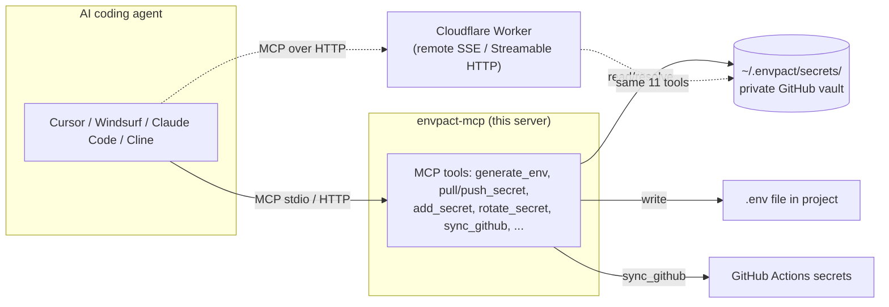

# envpact-mcp-server

> Bring your private, Git-backed secrets vault to any AI coding agent — generate `.env` files on demand, never paste an API key into a prompt again.

[](https://opensource.org/licenses/MIT)
[](https://github.com/chirag127/envpact-mcp-server/stargazers)
[](https://github.com/chirag127/envpact-mcp-server/commits)
[](https://nodejs.org)
[](https://www.npmjs.com/package/envpact-mcp)
[](https://github.com/chirag127/envpact-mcp-server/actions/workflows/ci.yml)
[](https://envpact-mcp-server.oriz.in)

**Model Context Protocol server for envpact** — bring centralized
secret management to AI coding agents (Cursor, Windsurf, Claude
Code, Cline, Goose, ChatGPT Desktop, and any other MCP-aware
client).

> Stop pasting API keys into prompts. Let your agent generate
> `.env` files from your private vault on demand.

**Links:** [Repo](https://github.com/chirag127/envpact-mcp-server) · [Live docs](https://envpact-mcp-server.oriz.in) · [envpact umbrella](https://chirag127.github.io/envpact/) · [Dashboard](https://envpact.oriz.in)

Part of the [envpact](https://github.com/chirag127/envpact)
ecosystem.

⭐ **If this is useful, please [star the repo](https://github.com/chirag127/envpact-mcp-server/stargazers)** — it helps other developers find it.

## Architecture



## What it does

When you ask your AI agent _"set up a Next.js project that uses
OpenAI and Stripe"_, modern agents can scaffold the code but get
stuck at the `.env` step. With envpact-mcp installed:

- The agent sees your project's `.env.example` requirements.
- It calls `generate_env` and the file is written from your
  private vault.
- New keys it discovers are added back to the vault via
  `add_secret`/`add_shared_secret`.
- Optionally syncs to GitHub Actions via `sync_github` so CI works
  end-to-end.

You never paste a secret into an agent prompt.

## Installation

The MCP server is published to npm as `envpact-mcp`. Configure your
AI client:

### Claude Desktop / Claude Code

`~/.config/claude/claude_desktop_config.json`:

```json
{
  "mcpServers": {
    "envpact": {
      "command": "npx",
      "args": ["-y", "envpact-mcp"]
    }
  }
}
```

### Cursor

`.cursor/mcp.json` in your project, or
`~/.cursor/mcp.json` globally:

```json
{
  "mcpServers": {
    "envpact": {
      "command": "npx",
      "args": ["-y", "envpact-mcp"]
    }
  }
}
```

### Windsurf

`~/.codeium/windsurf/mcp_config.json`:

```json
{
  "mcpServers": {
    "envpact": {
      "command": "npx",
      "args": ["-y", "envpact-mcp"]
    }
  }
}
```

### Cline (VS Code)

In Cline's MCP settings panel, add a stdio server with
command `npx` and args `["-y", "envpact-mcp"]`.

## Prerequisites

You need an envpact vault. If you don't have one yet:

```bash
npx envpact-cli --init auto
# Creates chirag127/envpact-secrets (private) and clones it to
# ~/.envpact/secrets/ — same vault every component reads.
```

## Available Tools

| Tool | Description |
| :--- | :--- |
| `generate_env` | Resolve secrets, write `.env` for the current project. |
| `list_projects` | List all projects in the vault. |
| `list_shared` | List shared secret names (values are masked). |
| `add_secret` | Add/update a project secret. |
| `add_shared_secret` | Add/update a shared secret. |
| `rotate_secret` | Rotate a shared secret; reports affected projects. |
| `sync_github` | Push resolved secrets to GitHub Actions. |
| `pull_secret` | Pull one key from vault → `.env` (per-key, conflict-safe). |
| `push_secret` | Push one key from `.env` → vault (per-key, conflict-safe). |
| `sync_status` | Report per-key sync status across `.env.example`. |
| `generate_global_env` | Mirror every shared secret into `~/.envpact/.env` (v3.1). |

Schema details: see [SHARED_SPEC §7](https://github.com/chirag127/envpact/blob/main/_build/specs/SHARED_SPEC.md).

## v3.1 UX additions

- **Dual-render timestamps (UTC + IST).** Every conflict refusal
  from `pull_secret` / `push_secret` and every entry in
  `sync_status` now carries the canonical UTC ISO string AND a
  human IST rendering (`YYYY-MM-DD HH:MM:SS IST`). Conflict
  payloads also expose `recommended_side: "vault" | "local"`
  set to whichever side is newer. The user keeps the final
  decision; `recommended_side` is just a hint.
- **Global vault `.env`.** `generate_global_env` mirrors every
  `shared.*` entry into a single file at `~/.envpact/.env`,
  generated from `~/.envpact/.env.example.global` (auto-created
  on first run, byte-faithful template format). Encrypted values
  emit `# KEY: encrypted` comments; missing keys emit `# KEY:
  not in vault`. Output is mode 0600 (best-effort on Windows).

## Per-key Sync (v3)

The vault is **flat and single-environment per project** with
`{value, _modified_at}` entries. The agent can sync one key at a
time without touching the rest of `.env`:

> **You**: "Pull the latest OPENAI_API_KEY from the vault."
>
> **Agent**: _calls `pull_secret({key: 'OPENAI_API_KEY'})`_ →
> writes the new value to `.env`, updates `.env.example.lock`.
> If you'd edited `.env` since the last sync, the call returns an
> `isError` payload with `status: 'local_newer'`; the agent
> retries with `force: true` only after asking you.

> **You**: "What's the sync status of this project?"
>
> **Agent**: _calls `sync_status()`_ → reports each key as
> `synced` / `local_newer` / `vault_newer` / `both_diverged` /
> `local_only` / `vault_only`. NEVER returns values.

## Example Agent Conversations

> **You**: "Set up envpact for this project. The .env.example
> needs OPENAI_API_KEY and DATABASE_URL."
>
> **Agent**: _calls `generate_env`_ → `.env` written, missing
> `DATABASE_URL`. Asks: "Should DATABASE_URL be a shared secret
> or project-specific?"
>
> **You**: "Shared, value is `postgres://prod-host/db`."
>
> **Agent**: _calls `add_shared_secret({key: 'DATABASE_URL', value: '...'})`_,
> then `add_secret({project: 'this-app', key: 'DATABASE_URL',
> value: 'shared.DATABASE_URL'})`, then `generate_env` again.
> Done — `.env` complete.

> **You**: "OPENAI_API_KEY was leaked. Rotate it everywhere."
>
> **Agent**: _calls `rotate_secret({key: 'OPENAI_API_KEY',
> new_value: 'sk-new...'})`_ → reports 12 affected projects.
> _Calls `sync_github` for each._

## Remote / SSE Variant

A Cloudflare Worker variant supporting MCP over Streamable HTTP is
deployed at `https://mcp.envpact.oriz.in/mcp` and listed on
Smithery at `https://smithery.ai/server/@chirag127/envpact-mcp`.
The Worker exposes the same 11 tools, with two natural Worker
deviations: `pull_secret` returns the resolved value as the
response text body (no `.env` to write), and `generate_global_env`
returns the rendered global `.env` body as text instead of writing
to disk. See `worker/README.md` for the full deviation list.

## Security Model

- Vault values never leave your machine in tool *responses* — only
  the tool params (e.g. when you ask the agent to set a value)
  carry plaintext.
- `list_shared` returns only names; values are never echoed.
- The MCP server reads/writes `~/.envpact/secrets/` directly. The
  vault is your existing private GitHub repo.
- All vault commits are signed-off (`-s`) and authored by
  `envpact-mcp`.

## Tech stack

- **Node.js** (>=18), **TypeScript**/ESM, pnpm workspace.
- **@modelcontextprotocol/sdk** for the MCP server; **zod** for tool schemas.
- **Cloudflare Worker** (`worker/`) for the remote SSE / Streamable-HTTP variant.
- Packaged as [`.mcpb`](./mcpb/) bundle and published to npm as `envpact-mcp`.

## Repo structure

```
src/            # MCP server (stdio) — tool handlers
worker/         # Cloudflare Worker (remote SSE / Streamable HTTP variant)
mcpb/           # .mcpb bundle manifest + build
docs/           # full API + usage reference (served at *.oriz.in)
scripts/        # test + build-mcpb helpers
server.json     # official MCP registry descriptor
smithery.yaml   # Smithery listing config
```

## Related projects — the envpact ecosystem

| Repo | Role |
| :--- | :--- |
| [envpact](https://github.com/chirag127/envpact) | Core (Python) vault library |
| [envpact-npm-cli](https://github.com/chirag127/envpact-npm-cli) | Zero-dependency Node CLI (`envpact-cli`) |
| **envpact-mcp-server** | MCP server for AI agents (this repo) |
| [envpact-gh-action](https://github.com/chirag127/envpact-gh-action) | GitHub Action — resolve secrets in CI |
| [envpact-registry-publisher-npm-cli](https://github.com/chirag127/envpact-registry-publisher-npm-cli) | Publish MCP servers to every registry |

## Part of the oriz family

One of ~80 [oriz](https://blog.oriz.in) projects — small, sharp,
open-source tools. The live docs run **$0 on the Cloudflare free tier**.

## Contributing

PRs welcome — see [CONTRIBUTING.md](./CONTRIBUTING.md). Conventional
commits are the changelog.

## Status

**Stable.** Published to npm; remote Worker variant listed on Smithery.

## License

MIT © 2026 Chirag Singhal · chirag@oriz.in — see [LICENSE](./LICENSE).

## Documentation

- **[Repo docs (`docs/README.md`)](./docs/README.md)** — full API + usage reference for envpact-mcp
- **[Project umbrella site](https://chirag127.github.io/envpact/)** — overview of all envpact components, security model, quick start
- **[Live dashboard](https://envpact.oriz.in)** — visual vault management
